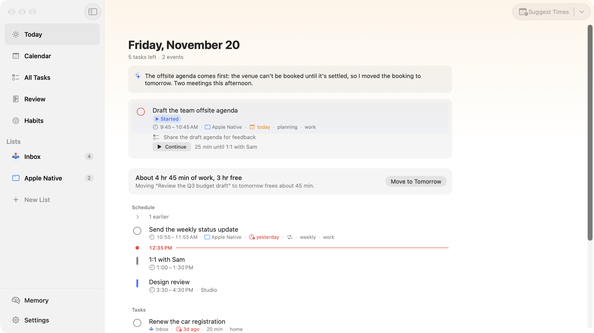
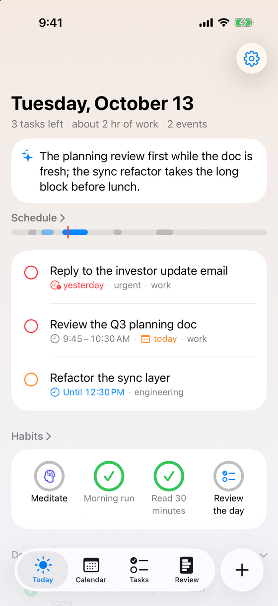
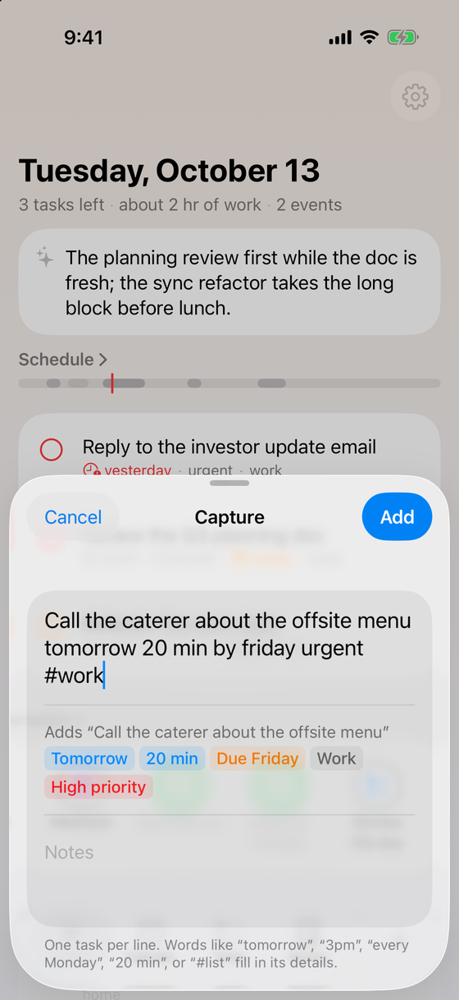
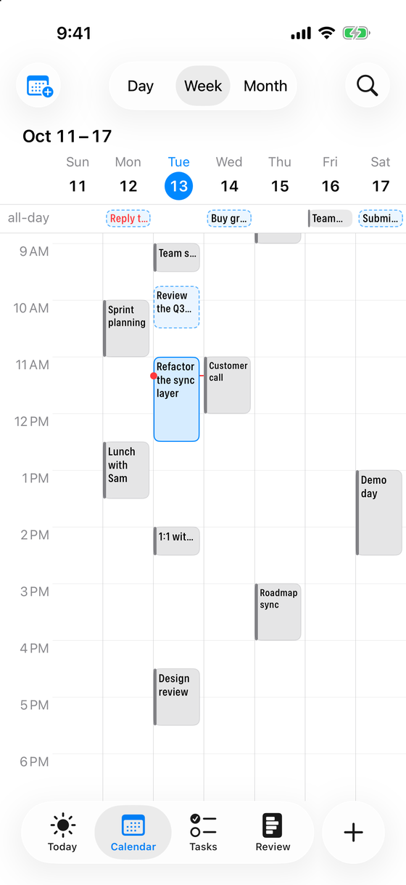

<div align="center">


# Lorvex

**Plan your day on Mac or iPhone, on your own or with your AI assistant.**

[](LICENSE)
[](apps/apple)
[](apps/apple)
[](apps/apple/docs/setup/ASSISTANT_MCP_SETUP.md)

[Website](https://lorvex.app) · [Download for Mac](https://github.com/boyugou/lorvex/releases/latest) · [Getting started](#getting-started) · [MCP setup](#connect-an-ai-assistant) · [Documentation](#documentation) · [Privacy](PRIVACY.md)

<br>



<br><sub>Mac Today in TestFlight 147</sub><br><br>

<table>
  <tr>
    <td align="center" width="33%"></td>
    <td align="center" width="33%"></td>
    <td align="center" width="33%"></td>
  </tr>
  <tr>
    <td align="center"><sub>Today, with the briefing your assistant wrote</sub></td>
    <td align="center"><sub>Quick add: one line, and its details fill in</sub></td>
    <td align="center"><sub>The week, events and tasks on one timeline</sub></td>
  </tr>
</table>

</div>

---

Ask your assistant to fit a writing session around your meetings. Open Today
after a meeting to pick up the next step on your checklist. If the afternoon
gets away from you, use Daily Review to pick another day. Your assistant sees the revised plan
the next time it reads Lorvex.

The Mac app gives a connected assistant 120 tools through the Model Context
Protocol (MCP), covering tasks, calendars, habits and reviews. You can plan
and edit directly on Mac, iPhone and iPad. With iCloud sync enabled, edits
you make on your phone reach the Mac and its connected assistant.

- **Local-first.** Everything lives in a SQLite database on your device. No
  accounts, no server of ours, fully usable offline.
- **Private sync.** Optional multi-device sync through your own iCloud
  (CloudKit private database) with encrypted payloads — multi-master,
  conflict-free (HLC clocks + last-writer-wins registers). We cannot read your
  data; there is nowhere for us to read it from.
- **No embedded AI, no tracking.** Lorvex ships no model, no analytics, no
  ads. Intelligence comes from *your* assistant, connected on *your* terms.
- **Native everywhere.** macOS, iPhone, iPad, Apple Watch, widgets,
  Shortcuts, Spotlight, and your system calendars through EventKit (events
  you create on the Mac are written back to Apple Calendar; iPhone and iPad
  read it).
- **Thirty languages.** The apps, widgets, and Shortcuts follow your system
  language, from Arabic to Vietnamese, right-to-left scripts included.

## How it works

```
┌──────────────┐   MCP (stdio)   ┌───────────────┐        ┌──────────────────┐
│ AI assistant │ ◄─────────────► │ LorvexMCPHost │ ◄────► │  Pure-Swift core │
│  (Claude, …) │    120 tools    │ (MCP server)  │        │  SQLite (GRDB)   │
└──────────────┘                 └───────────────┘        └────────┬─────────┘
                                                                   │ encrypted
┌──────────────┐   read / act    ┌───────────────────────┐         │ envelopes
│     You      │ ◄─────────────► │ Native apps & widgets │ ◄───────┴────────►  your iCloud
└──────────────┘                 └───────────────────────┘   (CloudKit private DB,
                                                              multi-master sync)
```

Every mutation — human or AI — flows through one audited write surface with
idempotency keys and a changelog, then syncs as an encrypted envelope in your
private CloudKit database. Other devices merge deterministically; no device is
"the server."

## Repository layout

The repository holds the Apple app plus the contracts it owns:

```
lorvex/
├── apps/
│   └── apple/     Apple-native app — Swift 6, SwiftUI/AppKit, SwiftPM.
├── schema/        SQLite schema (the Apple app's authority) + sync payload manifests.
├── cloudkit/      CloudKit record-type template and deploy tooling (Apple-owned).
├── spec/          Cross-implementation behavior contracts: docs + test-vector fixtures.
└── docs/          Project-level documentation (see docs/INDEX.md).
```

Lorvex began as a cross-platform Tauri app. That implementation was removed on
2026-09-17; this repository is the Apple-native app only.

## Install

**Mac:** download `Lorvex-macOS-arm64.dmg` from the
[latest release](https://github.com/boyugou/lorvex/releases/latest), open it,
and drag Lorvex to Applications. It needs a Mac with Apple silicon and macOS 26
or later, is notarized by Apple, and syncs with Lorvex on your other devices
through your iCloud account. The DMG does not update itself; the newest build
is always on the same releases page.

## Getting started

### Apple app (macOS)

Use Xcode 26.3 or newer for development and Xcode 27.x for release archives.
The app targets macOS 26, iOS 26, and watchOS 26.

```bash
cd apps/apple
./script/verify_swift.sh --core   # build, compile string catalogs, run app and core tests
./script/build_and_run.sh --verify   # build, verify, and launch the macOS app
```

iOS / watchOS build through the XcodeGen-generated project — see
[`apps/apple/CLAUDE.md`](apps/apple/CLAUDE.md) for the full developer manual
and [`apps/apple/docs/release.md`](apps/apple/docs/release.md) for packaging.

## Connect an AI assistant

With Lorvex installed, open **Settings → Assistant** and copy the setup prompt
or the config for your client. In Claude Code, the Lorvex plugin sets up the
connection and adds skills for planning a day, capturing tasks, the weekly
review, and tidying the assistant's memory
([`plugins/lorvex`](plugins/lorvex/README.md)):

```
/plugin marketplace add boyugou/lorvex
/plugin install lorvex@lorvex
```

From a source checkout, build the MCP host and point any MCP-capable client at
it:

```bash
cd apps/apple && swift build -c release --product LorvexMCPHost
```

```json
{
  "mcpServers": {
    "lorvex": {
      "type": "stdio",
      "command": "/path/to/lorvex/apps/apple/.build/release/LorvexMCPHost"
    }
  }
}
```

Full client-by-client instructions (Claude Desktop, Claude Code, and others):
[`apps/apple/docs/setup/ASSISTANT_MCP_SETUP.md`](apps/apple/docs/setup/ASSISTANT_MCP_SETUP.md).

## Documentation

| Topic | Where |
|---|---|
| Documentation index | [`docs/INDEX.md`](docs/INDEX.md) |
| Design philosophy & non-goals | [`docs/vision/DESIGN_PHILOSOPHY.md`](docs/vision/DESIGN_PHILOSOPHY.md) |
| Assistant operating model (instructions, skills, tool design) | [`docs/design/AI_OPERATING_MODEL.md`](docs/design/AI_OPERATING_MODEL.md) |
| Sync semantics (HLC, LWW, idempotency) | [`docs/design/SYNC_APPLY_SEMANTICS.md`](docs/design/SYNC_APPLY_SEMANTICS.md) |
| Schema & data-infrastructure invariants | [`docs/design/SCHEMA_OPTIMALITY.md`](docs/design/SCHEMA_OPTIMALITY.md) |
| Export / backup format | [`spec/EXPORT_FORMAT.md`](spec/EXPORT_FORMAT.md) |
| Feature inventory | [`apps/apple/docs/reference/FEATURES.md`](apps/apple/docs/reference/FEATURES.md) |
| User guide | [`apps/apple/docs/USER_GUIDE.md`](apps/apple/docs/USER_GUIDE.md) |
| Roadmap & status | [`ROADMAP.md`](ROADMAP.md) |

## Status

Mac and iOS updates reach internal testers through TestFlight. Each
[release record](docs/releases) lists what changed and which builds are
available. The [public Mac download](https://github.com/boyugou/lorvex/releases/latest)
is signed and notarized. See the [roadmap](ROADMAP.md) for ongoing work.

## Privacy

Local data, your iCloud, our zero access — the full policy is in
[`PRIVACY.md`](PRIVACY.md). Lorvex collects nothing: no accounts, no
analytics, no telemetry, no third-party services.

## Contributing & support

- Contributions: see [`apps/apple/docs/CONTRIBUTING.md`](apps/apple/docs/CONTRIBUTING.md).
- Issues and feature requests: [GitHub Issues](https://github.com/boyugou/lorvex/issues).
- Support: [lorvex.app/support](https://lorvex.app/support/).
- Security issues: report them privately, as described in [`SECURITY.md`](SECURITY.md).

## License

[Apache-2.0](LICENSE)
