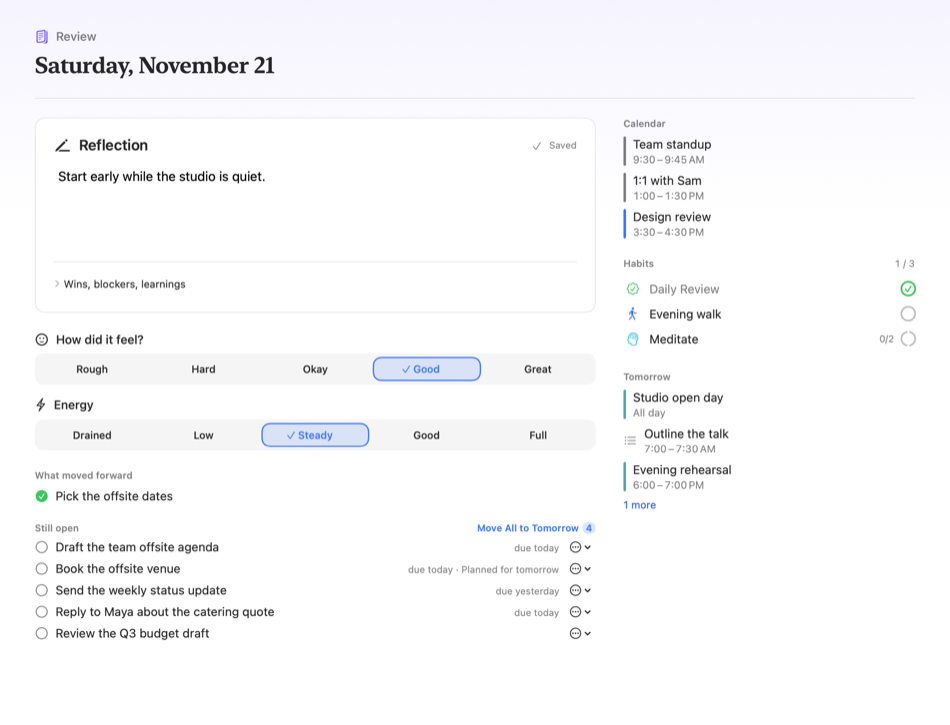

# Lorvex 1.0.0 (158)

[Download for Apple silicon Macs](https://github.com/boyugou/lorvex/releases/tag/v1.0.0%2B158). Requires macOS 26 or later.
Also on internal TestFlight for iPhone, iPad and Mac. [Build source](https://github.com/boyugou/lorvex/commit/85d5e44527a5342ee30578287b2c7ed1278322aa).

## Tomorrow in Daily Review

A morning work block now appears before an evening meeting. Daily Review uses
the same clock order as Today, with all-day events at the top and tasks without
a time at the bottom. On Mac, the context column previews three commitments
and lets you expand the rest. Each task opens its details.

The Mac review editor was rendered over a seeded store with a saved reflection,
mood, energy, three appointments, habits and open tasks. The Tomorrow column
showed the all-day event, morning task, evening meeting and a one-item disclosure.

An iPhone 17 Pro simulator displayed an all-day event, a 7 AM task, an evening
rehearsal and an untimed task in that order. Opening the morning task and
returning to Review preserved the journal text. Shared agenda tests also cover
overnight events, identical task and event titles, tied starts and untimed task order.

## Mac workspace navigation

The main window now owns the native search field as a sibling to its content.
Previously, moving between Calendar and Today in the sample-data tour could
terminate the app when AppKit received two search items. Build 157 reproduced
the exception twice in the tour. Attempts in its regular window did not
reproduce the crash.

On build 158 the complete Mac tour captured 64 views. A separate check in the
regular app window performed 24 rapid workspace switches, verified the native
search fields and list-specific prompt, then used the Find menu shortcut, typed
text and cleared the query with Escape. The tour driver now reports failure if
the app exits before the last stop.

## Distribution

The Swift suites, static gates and localization argument checks passed.
Apple validated both TestFlight packages. Existing internal groups have the
build in **IN_BETA_TESTING** with English and Simplified Chinese testing notes.
Both expire on **2027-02-19**.

Apple notarized the direct app and disk image. Gatekeeper accepted the image.
An anonymous download matched the signed image and its published checksum.
The installed-copy test that resets the production store was skipped on the
development Mac.

**DMG SHA-256** `51b4665b7bcaae1b57c20a5fd0862d165c34c4765c089f382fc5fd1d15c9a9e1`
