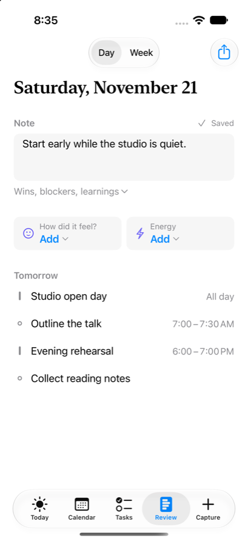

# Lorvex 1.0.0 (160)

Available on internal TestFlight for iPhone, iPad and Mac. [Build source](https://github.com/boyugou/lorvex/commit/8f5b8000ee1fd0207852b516554d429b584e1e85). The [direct Mac download](https://github.com/boyugou/lorvex/releases/tag/v1.0.0%2B158) is build 158.

## Write a daily note on iPhone or iPad

Open **Review** and write in the note. After a short pause, **Saved** appears
beside the heading. You can keep the keyboard open while the note saves.
Feeling and energy sit below the note. Tap either to choose or clear a rating.

The two rating controls now have equal height. At larger text sizes they
stack so each label can use the available width. With the same journal and
schedule on an iPhone 17 Pro at its default text size, Tomorrow begins about
128 points higher than in build 158.

## Verification

On iPhone 17 Pro and iPad mini simulators, the UI test typed into an existing
entry, waited for Saved with the keyboard still open and read the text after
relaunch. It also set and cleared independent ratings, checked their touch
targets and alignment, selected energy at the largest accessibility text size
and read the two ratings in succession with VoiceOver. A separate database
read found the original note, the new words and both cleared values on each
device. A Simplified Chinese iPhone capture showed 已保存 above the note,
followed by the two rating controls and 明天.

The Swift suites, static gates and localization argument checks passed.
Both signed builds reached **VALID** and **IN_BETA_TESTING** for the existing
internal groups. English and Simplified Chinese testing notes were read back.
The builds expire on **2027-02-19**.
