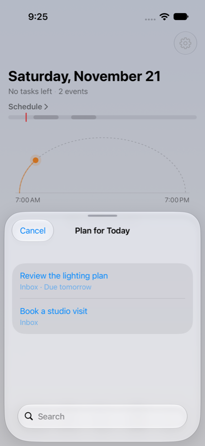

# Lorvex 1.0.0 (161)

Available on internal TestFlight for iPhone, iPad and Mac. [Build source](https://github.com/boyugou/lorvex/commit/ddb8b0ee09e34941c35356ba3d4b4365617fea0d). The [direct Mac download](https://github.com/boyugou/lorvex/releases/tag/v1.0.0%2B158) is build 158.

## Choose existing work for today

On iPhone or iPad, **Select a Task** appears under the sun when Today has no
open or completed tasks and a list has available, unplanned work. Open it to
see tasks in priority and deadline order. Search for a title or use **Show
more** to reach later results. Each row shows its list and any deadline.
Tap one to plan it for today, or cancel to keep the day free. **Undo** removes
the work date. A selection or undo skips a task whose saved plan has since changed.

The task inspector’s single-field editor now owns its draft. Adding a deadline
from the Inbox previously opened a blank sheet during the iPhone and iPad
walkthrough. Both now display the date controls and save the selected day.

## Verification

The native walkthrough created an Inbox task, set tomorrow as its deadline,
opened the picker, cancelled, chose the task, undid the choice and chose it
again. On iPhone 17 Pro and iPad mini, reopening the app showed that same
task on Today with its original deadline. Independent SQLite reads confirmed
one planned Inbox task per device. Store tests also covered a named list,
paginated search, unavailable tasks, a concurrent plan change and a title
edit made between scheduling and undo. A second native walkthrough on both
devices searched for “lighting” and narrowed two candidates to the task
that contained the word. On a landscape iPad mini the existing agenda already
named the next appointment beside Today.

The Swift suites, static gates and localization checks passed. Both signed
packages reached **VALID** and **IN_BETA_TESTING** in the existing internal
groups, with English and Simplified Chinese testing notes. The builds expire
on **2027-02-19**.
