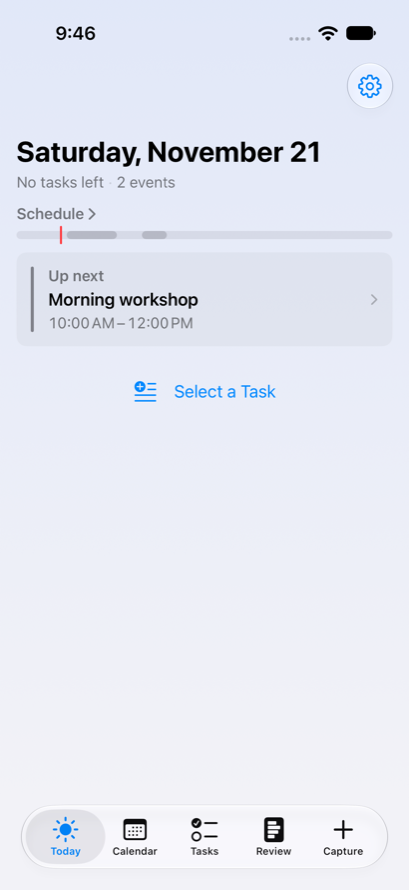

# Lorvex 1.0.0 (162)

Available on internal TestFlight for iPhone, iPad and Mac. [Build source](https://github.com/boyugou/lorvex/commit/cd684838deba86ab7967c5099114d4245fc62ecd). The [direct Mac download](https://github.com/boyugou/lorvex/releases/tag/v1.0.0%2B158) is build 158.

## The next meeting on Today

On iPhone and in a narrow iPad window, Today shows the current appointment
or the next one with its name and time. Tap the appointment to open its
details. **Schedule** still opens the full day. After the last timed
appointment, an all-day event can take its place. A wide iPad window
continues to show the agenda alongside the task list.

## Verification

Using the same two saved appointments on an iPhone 17 Pro and an iPad mini
simulator, the previous phone build showed the event count and two bars.
On build 162 the compact layouts displayed the workshop and its time.
Tapping opened the saved event. Cancelling returned to Today and both event
times remained intact. Rotating the iPad exposed the wide agenda.

The simulator also displayed an ongoing meeting, a day after all timed
events ended, an all-day event, and a day with both a planned task and a
meeting. On days with only an all-day or a past event, the headline now reads
“No tasks left”. At the largest accessibility text size the all-day title
wraps and the task picker button shows its full label. Automated tests covered meeting boundaries, overlapping and
overnight events, cancelled occurrences and both readings of the repeated
hour when daylight saving ends.

Both signed packages reached **VALID** and **IN_BETA_TESTING** with English
and Simplified Chinese notes in their internal groups. They expire on
**2027-02-19**.
