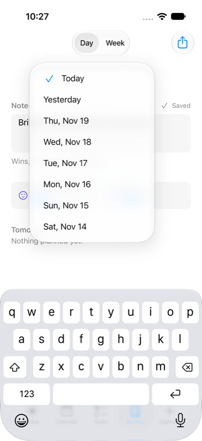

# Lorvex 1.0.0 (163)

Available on internal TestFlight for iPhone, iPad and Mac, and as a
[notarized Mac download](https://github.com/boyugou/lorvex/releases/tag/v1.0.0%2B163). [Build source](https://github.com/boyugou/lorvex/commit/8b104acedfbc6d3afe1db38fab05a43c3fe24403).

## Write yesterday's entry

Open **Review → Day** on iPhone or iPad and tap the date. Choose **Yesterday**
or another date from the previous seven days, even when there is no entry yet.
Write a note or set a rating, then choose **Return to Today**. Opening a date
from the weekly journal first displays its saved writing and ratings. **Edit**
opens a recent entry for changes. Past tasks and habit check-ins remain
available as context.

## Preserve independent edits

Mac and mobile journal editors now save the text fields and ratings the person
changed. A change to another field that has already reached the local store is
preserved in the same write transaction. For example, a win saved while a note
is open survives when that note autosaves. Deliberately clearing a rating or
written section still clears it.

## Verification

On iPhone 17 Pro and iPad mini simulators, the walkthrough typed today's note,
switched to an empty yesterday, wrote a second note, set its energy, returned to
today and opened yesterday from the weekly journal. After relaunch the two
dates still showed their respective entries. A second writer then saved a win
while yesterday's note was open. The original mobile editor erased that win
when its note saved. In the fixed build, independent SQLite reads found the
edited note, the other writer's win and the original energy rating together on
yesterday. Today's note was intact. This exercise used local test stores.

Mac and mobile store tests also saved independent fields in opposite orders
and cleared individual fields. A native Mac text editor retained its selection
when a win arrived during typing. The Swift and static suites passed.

Both signed TestFlight packages were verified in their existing internal
groups with English and Simplified Chinese notes and expire on **2027-02-19**.
The public Apple silicon DMG and its app were signed, notarized and stapled.
The final disk image was mounted for read-only verification. Runtime testing
used isolated stores and simulators. The published download was fetched
anonymously and its SHA-256 matched `89234e1b1912c086e4fa5308d27b5cad00d744686d461c7291dfcc9e1d6a5dc7`.
