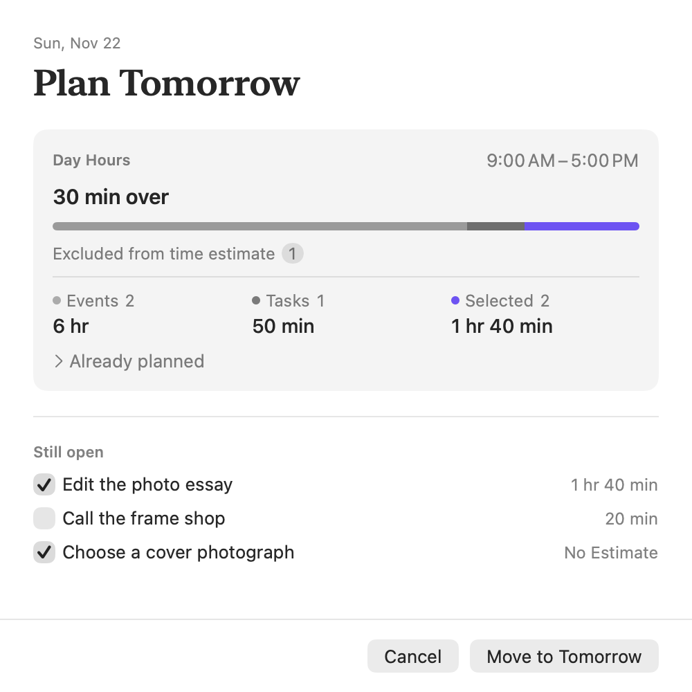

# Lorvex 1.0.0 (164)

Available on internal TestFlight for iPhone, iPad and Mac, and as a
[notarized Mac download](https://github.com/boyugou/lorvex/releases/tag/v1.0.0%2B164). [Build source](https://github.com/boyugou/lorvex/commit/7a18b3c9753bc35de73de5488f518f4cfaba8b06).

## Plan tomorrow from Daily Review

On Mac, open **Review → Day → Still open → Plan Tomorrow…**. Uncheck any work
you want to leave where it is. The forecast updates as you choose. It shows
calendar time within your working hours, the work already on tomorrow’s list,
and the estimates attached to your selection. Overlapping events use the same
minutes once. Tasks without a known duration have their own count. Expand
**Already planned** to see the appointments and task names behind the totals.

**Move to Tomorrow** applies the selection together. **Edit → Undo** returns
those tasks to their previous plans. On both Mac and mobile, tomorrow’s Review
agenda includes actionable tasks beyond the old 50-row limit.

## Verification

In the regular Mac preview window over an isolated store, two overlapping
appointments occupied six hours, existing work took 50 minutes, and selecting
all three unfinished tasks added two estimated hours and one unestimated
task. Leaving a 20-minute task behind changed the forecast from 50 minutes
over the day’s hours to 30 minutes over. The walkthrough expanded the agenda,
cancelled a selection, applied a partial move, checked the stored plans, and
undid the move. Service and store tests also checked a quiet day, the saved
working window, and a destination with 54 open tasks.

The app, service, core and static suites passed. Apple processed both signed
TestFlight packages and made them available in their existing internal groups
with English and Simplified Chinese notes. They expire on **2027-02-19**.
The direct-download app and DMG were signed, notarized and stapled. The final
disk image was mounted read-only and an anonymous download matched the signed
DMG’s SHA-256, `d5ef39be461c28f714fc95b9fb5092dc4dae93f9b3baca8f3cee7060e701a14b`.
