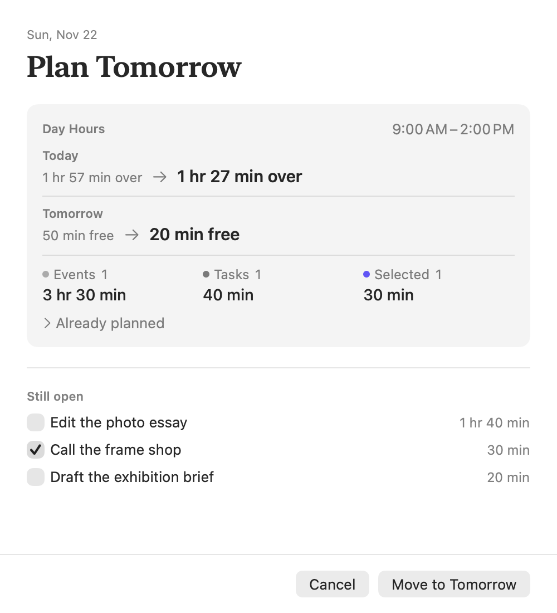

# Lorvex 1.0.0 (166)

Available on internal TestFlight for iPhone, iPad and Mac, and as a [direct Mac download](https://github.com/boyugou/lorvex/releases/tag/v1.0.0%2B166). [Build source](https://github.com/boyugou/lorvex/commit/df2d565bb3f2d1667d12302b9fde746e9696358e).

## A two-day decision on Today

When Today has more estimated work than remaining working time, choose
**Plan Tomorrow**. The preview shows both days before and after the proposed
move. You can expand **Already planned** to see tomorrow’s appointments and
tasks. The least urgent eligible tasks that cover the excess are checked first.
Uncheck a suggestion or choose another flexible task. Started work, time slots
on today’s calendar, and deadlines today or earlier stay out of the suggestions.

**Move to Tomorrow** applies the selection in one transaction. **Edit → Undo**
on Mac or **Undo** in the mobile banner restores the earlier plans. A task
carried from yesterday can return to yesterday. Confirmation checks the current
product day and skips tasks whose schedule, status or estimate has become
ineligible in the meantime.

On mobile, Today loads the saved working hours when local data becomes
available on launch. A working-hours edit in Settings also updates Today.

## Verification

In the Mac walkthrough, tomorrow’s 9 am–2 pm working day held a 3½-hour
workshop and 40 minutes of planned work. Moving both suggested tasks
would take the day 80 minutes over. Choosing just the 30-minute task left
20 minutes free tomorrow and reduced today’s excess by 30 minutes. The
walkthrough cancelled a preview, applied a partial move, chose an alternative
and undid each move in the native window.

The iPhone 17 Pro and iPad mini simulator walkthroughs covered a cold launch,
the unfolded agenda, a one-task move, Undo, and the previously unchecked
alternative. A database read confirmed the resulting dates. The Chinese
walkthrough kept its selection across rotation. The largest Dynamic Type
size kept the task list and confirmation reachable.
[Chinese iPhone walkthrough image](../images/iphone-today-transfer-166-zh.png).

The app, service and static suites passed. The signed packages contain the
comparison strings in all 30 interface languages. Both TestFlight builds are
available in their existing internal groups with English and Simplified Chinese
notes and expire on **2027-02-19**. The Developer ID app and DMG were signed,
notarized and stapled. Distribution verification used the package-only path
on the daily-use Mac. The anonymous download matched the packaged disk
image’s SHA-256, `796de977c10595c3efd0c922c1c76cb19934ce2507a6c0be6092f1b126295315`.
