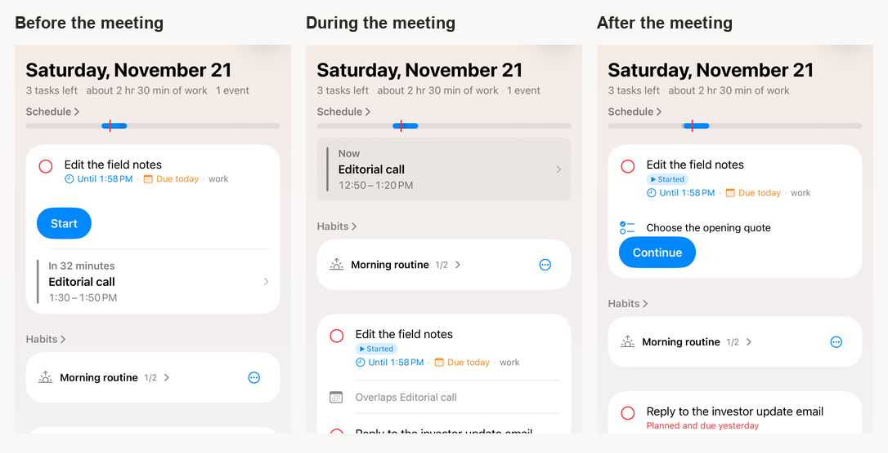

# Build 167 · Continue a task around a meeting

Available on internal TestFlight for iPhone, iPad and Mac. [Build source](https://github.com/boyugou/lorvex/commit/0d89be307ed5d364261c92dfe0973ed74cce5971).

Mobile Today gives a task in its scheduled time a **Start** button. Tapping
it starts the task and opens its details. Returning to Today shows
**Continue** with the first unfinished checklist item. A started task without
a time slot can also appear here.

Before a meeting, the compact layout shows its countdown and actual times
together. Tap the appointment to open it. While a timed meeting is underway,
Today holds back the work button. When the meeting ends, the person can pick
up their started task. Browsing another week in Calendar keeps that week on
screen and Today retains its own appointments.

## Verification

The iPhone 17 Pro and iPad mini simulator walkthroughs started a timed task,
reopened Today after relaunch, and continued into the same task. Both devices
opened the meeting from Today. During the meeting the work button disappeared.
Afterward, the checklist and Continue were reachable at the largest Dynamic
Type size in Simplified Chinese and dark appearance.

A regression test browses six weeks ahead, checks the calendar immediately
before, during, and after a meeting, and taps a Start offer after the meeting
has begun. The task stays open until Start is tapped while the time is free.

The signed iOS archive contains the new action text in all 30 supported languages. Apple processed both builds and made them available to the existing internal testing groups with English and Simplified Chinese testing notes. Both expire on **2027-02-19**.

The public Mac download for the preceding release is available from
[build 166](https://github.com/boyugou/lorvex/releases/tag/v1.0.0%2B166).
