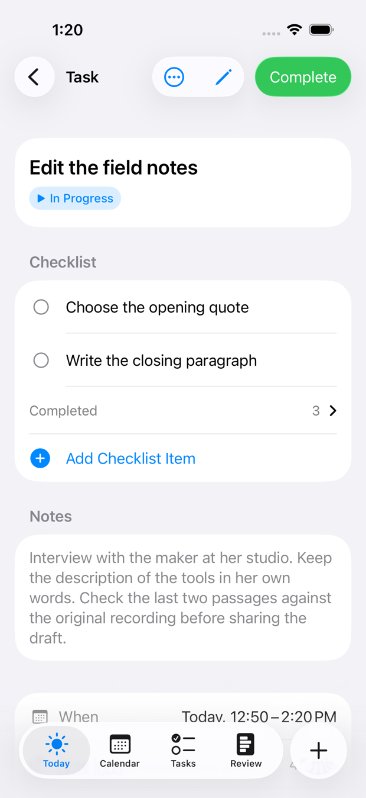

# Build 168 · Resume at the next checklist step

Available on internal TestFlight for iPhone, iPad and Mac. [Build source](https://github.com/boyugou/lorvex/commit/10c547900ff16aef990d8837f86268644d901c08).

On iPhone and iPad, **Continue** from Today opens a started task with its
remaining checklist directly below the title. The steps keep their order.
Check one off to bring the following step up. Expand **Completed** to read
or reopen an earlier step. Finishing the checklist leaves completion of the
task itself in your hands.

Notes and editable task properties follow the active checklist. A task with
no saved steps can add its first one from **Add Detail → Checklist**.

## Verification

The native iPhone 17 Pro and iPad mini walkthroughs covered a five-step task
with three finished steps, notes and a saved deadline. Checking off the next
step, moving the deadline, and reopening Today after relaunch showed the
following step. Both devices then finished the checklist and reopened its last
step. Reading the test databases confirmed the task was still in progress
with the new deadline, the original planned day and the four completed steps.

Both devices also reopened a step in Simplified Chinese at the largest Dynamic
Type size in dark appearance. A native regression test creates a task through
Capture, starts it, adds its first step and completes and reopens that step.

Apple processed the iOS and macOS builds and made them available to the existing
internal testing groups with English and Simplified Chinese testing notes.
Both expire on **2027-02-19**. The current direct Mac download is
[build 166](https://github.com/boyugou/lorvex/releases/tag/v1.0.0%2B166).
