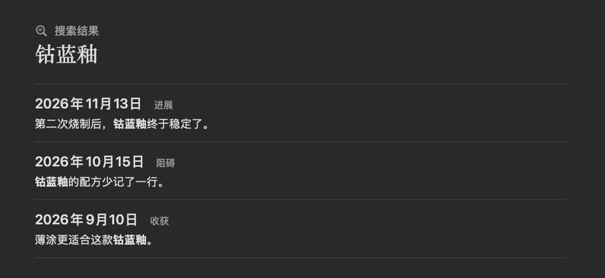

# Lorvex 1.0.0 (169)

In **Review** on Mac, press **Command-F** and type a phrase from your journal.
Search covers the main note, wins, blockers, and learnings across recorded days.
Each result shows its date, the field containing the phrase, and an excerpt.
A win or blocker can be found even if you left the main note blank.

Select a result to open that day. Use **Search Results** or **Command-[** to
return. The search keeps your phrase, loaded pages, and scroll position.
Recent entries follow the usual editing rules. Older entries open for reading.

The native Mac walkthrough used an in-memory journal. It checked a pending
edit before opening an old entry, followed two matches in Chinese, then
loaded a second page in a 36-match search in English. Opening result 35 and
going back restored the same scroll offset and let the user read result 36.
A database test searched past a 64-day batch boundary, including accented
text, multiline text, and literal wildcard characters.

[Direct Mac download](https://github.com/boyugou/lorvex/releases/tag/v1.0.0%2B169) · [Build source](https://github.com/boyugou/lorvex/commit/687dfcdb05b22e49b89f232e13829a0666f46cc1).
The Developer ID app and disk image passed notarization and were stapled. The
public download matched the packaged SHA-256, `ca78ae5e28657e2d068ef2acd185f0c869c9a6d3b77dda4ed7cd1f47717262bc`. The
direct package used the verification path for a Mac holding real data.
Apple validated the signed iOS and Mac packages. Both are available to
the existing internal TestFlight groups with English and Simplified Chinese
test notes and expire on **2027-02-20**. Journal phrase search ships on Mac in
this build.
