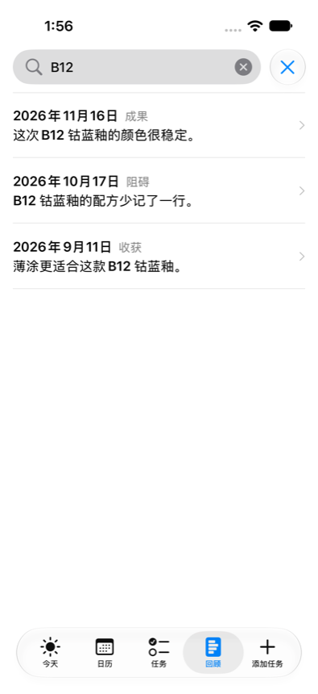

# Lorvex 1.0.0 (170)

On iPhone or iPad, open **Review** and search for a phrase from any recorded day.
Results show the date, field, and an excerpt with the matching words emphasized.
The search includes entries with just a win, blocker or learning.

Tap a result to read the full entry. **Done** returns to the same place, including
later pages of a long search. Opening a result leaves the day or week you were
reviewing in place. **Edit** on a recent entry opens the existing daily editor
for that date.

## Verification

The iPhone 17 Pro and iPad mini simulator walkthroughs found three entries
with an empty main note, the oldest from 73 days earlier. Both preserved today's
pending note through search, reading two entries, and relaunch. Opening result
35 in a 36-match search and
returning preserved the scroll position. A separate walkthrough found and
edited yesterday's entry. Database reads confirmed the edits on their intended
days. Clearing a search with no matches kept the field ready for the next
phrase on both devices. At the largest text setting, the Chinese reader and
search results remained usable across rotation. On the iPhone Duo simulator's
outer display in dark mode, the walkthrough cleared a query, found yesterday's note
and edited it. A database read confirmed the edit on the intended date.

Apple validated both signed packages. The existing iOS and macOS internal
TestFlight groups have build 170 with English and Simplified Chinese test
notes through **2027-02-20**. Mac journal search is also available in the
[build 169 direct download](https://github.com/boyugou/lorvex/releases/tag/v1.0.0%2B169).
[Build source](https://github.com/boyugou/lorvex/commit/6586d955250c8daa12feeb87e6d5716ab8ac6165).
