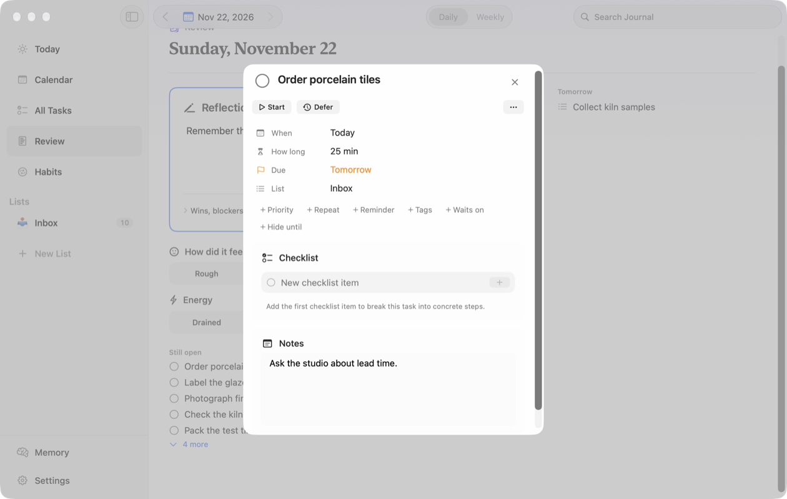

# Lorvex 1.0.0 (171)

In Mac **Daily Review**, click a task under **Still open** or **Tomorrow** to
check its deadline, edit its details or work on its checklist. The editor opens
over the journal. Close it to return to the entry at the same scroll position.
The separate Review window also keeps the main window's selected task in place.

## Verification

In a wide native window, the walkthrough typed in the journal, immediately
opened an unfinished task, chose tomorrow as its deadline, edited its title
and closed it with the last edit still pending. Independent reads found the
new title and deadline, the original plan for today and the journal entry.
The updated title was visible in Review at the original scroll offset.
After completing a task in its editor, Undo reopened it both from the editor
and after returning to the journal. Each action was undone once, and the
recently typed journal text survived.

In a 730-point standalone Review window in dark mode, a second walkthrough
opened a task in tomorrow's agenda and saved its new title. The original
entry, scroll position and main window selection were preserved. Both
walkthroughs used an in-memory database.

## Get the build

The iOS and Mac internal TestFlight groups have build 171 with English
and Simplified Chinese tester notes through **2027-02-20**. This build adds the
in-place task editor on Mac.

The Apple silicon app and disk image passed Developer ID signing,
notarization and stapling. An anonymous download of the published disk image
matched the local SHA-256, `61df370744f7de1980c875689e14b34247dfbac821f923f0eb0151f4691be466`. The direct package used the
read-only verification path for a Mac holding real data.
[Current Mac download](https://github.com/boyugou/lorvex/releases/latest) ·
[Build source](https://github.com/boyugou/lorvex/commit/8a8153ecccd8cca6a7ccc5c7541cc1b8c70e6b50).
