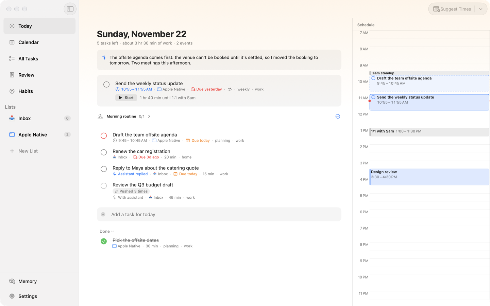

# Lorvex 1.0.0 (172)

On Mac, **Today** in a wide window now shows the day on a time grid beside the
task list. Calendar events and timed tasks are drawn to scale, a red line marks
the current time, and free time is the room between the blocks. Drag a task
from the list onto the grid to give it a time, drag a block to move it or its
edge to change its length, and click or drag on free time to add an event. The
list holds every task once. A narrow window, and Today opened in its own
window, keep the schedule in the list as before.

Also in this build:

- In Mac **Daily Review**, click an event to preview its time, location and
  notes over the journal.
- On iPhone and iPad, a sheet below full height (Capture, New List, New
  Memory) has a material background, so the screen behind it no longer shows
  through the form.
- A Mac list preview card shows a task's deadline under its title.
- A Mac window at its minimum width now always grows to fit the inspector.
  Before, the window sometimes stayed 1000 points wide with the inspector
  open, which pushed half of the sidebar off screen: 6 of 18 measured launches
  failed, and 10 of 10 passed after the fix.

## Verification

The full suites passed on the commit before the build number changed: 218
core tests and 5,197 app tests. Every static gate passed.

The preview app was captured with seeded data at 1440 by 900 and 1180 by 720
points in light mode, at 1180 by 720 in dark mode, and at 1000 by 600 with an
event open. In each wide capture the grid stands beside the list. Opening an
event puts the inspector in the grid's place, and closing it brings the grid
back; at 1440 points the capture after closing is byte-identical to the one
before opening. The 1000-point window grew to 1320 points for the inspector
and kept the schedule in the list.

Two independent reviews read the change before it was committed, one for
logic and one for documentation. The logic review found ten issues, among
them that the main window and a separate Today window overwrote each other's
row order for the arrow keys, and that the grid could open on the wrong hour
when a window reported a size that did not hold. All ten are fixed, and the
rules they touch now have behavior tests.

Not exercised by automation: dragging a task from the list onto the grid. The
grid's drop handling is the Calendar workspace's own, which Calendar already
uses.

## Get the build

The iOS and Mac internal TestFlight groups have build 172 with English and
Simplified Chinese tester notes through **2027-02-20**. Both builds were read
back from App Store Connect as `VALID` and `IN_BETA_TESTING`.

The Apple silicon app and disk image passed Developer ID signing,
notarization and stapling. An anonymous download of the published disk image
matched the local SHA-256, `36e06429be3a7e6c1e17833bdb608f6aacbfb6b09853eed248cfc9bf93e04d92`. The direct package used the
read-only verification path for a Mac holding real data.
[Current Mac download](https://github.com/boyugou/lorvex/releases/latest) ·
[Build source](https://github.com/boyugou/lorvex/commit/1a112e95341aa38fd2aeb7a28bc210b272291eec).
